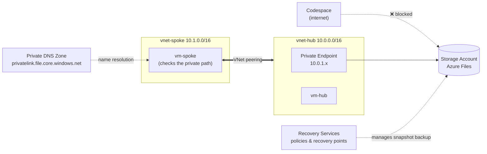

# 🔒 Azure Private Networking & Data Protection Hands-on Lab

🌐 [한국어](README.md) | **English**

[](https://codespaces.new/Taeyangmoon/azure-private-net-data-lab)
[](LICENSE)

> **Scenario**: Build a **private access path** for a corporate file share and inspect its **backup policy and recovery points**.

All you need is a browser. Every step runs in a **GitHub Codespaces** terminal with the Azure CLI. (About **75 minutes**)

**Shared keys and public data access stay disabled throughout.** The basic lab does not mount SMB shares, write/delete files, or restore file contents. You do not need to change organizational policies or directly retrieve account keys.

## 🗺️ Final architecture



## 📚 Modules

| Module | What you do | Time | Guide |
|---|---|---|---|
| 0. Setup | Deploy hub & spoke VNets, small test VMs, a storage account | 10 min | [00-setup](docs/en/00-setup.md) |
| 1. VNet peering | Configure hub-spoke peering and test connectivity | 15 min | [01-vnet-peering](docs/en/01-vnet-peering.md) |
| 2. Private Endpoint | Configure Private Link/private DNS; compare private IPs and internet 403 vs. VM 401 | 20 min | [02-private-endpoint](docs/en/02-private-endpoint.md) |
| 3. Azure Files | Create a share through the management plane; inspect quota, protocol, and access path | 10 min | [03-azure-files](docs/en/03-azure-files.md) |
| 4. Azure Backup | Configure Snapshot backup policy/protection; run backup and inspect recovery points | 15 min | [04-azure-backup](docs/en/04-azure-backup.md) |
| Cleanup | Stop protection and delete the vault | 5 min | [05-cleanup](docs/en/05-cleanup.md) |

## ✅ Prerequisites

- **Azure subscription** with permission to create resource groups (**Contributor or higher**).
- **GitHub account** for Codespaces (the free quota is enough).
- **Storage policy**: keep `allowSharedKeyAccess=false` and `publicNetworkAccess=Disabled`. SMB exercises requiring policy exemptions or shared keys are excluded.
- **Region**: defaults to `koreacentral`. To change it, run e.g. `export LOCATION=westeurope` before Module 0.

## 🚀 Getting started

1. Click **Open in GitHub Codespaces** above, or choose **Code ▸ Codespaces ▸ Create codespace** in the repository.
2. Sign in to Azure in the Codespace terminal.
   ```bash
   az login --use-device-code
   az account show -o table      # make sure it's the right subscription
   ```
   With multiple subscriptions, pick one using `az account set -s "<name or ID>"`.
3. Start with [Module 0](docs/en/00-setup.md) and go in order.

> 💡 **In every new terminal**, run `source scripts/env.sh` to load the shared variables (`$RG`, `$SA`, …).

If you set custom `RG` or `LOCATION` values, export the same values first in each new terminal. Cleanup deletes everything in `$RG`; use a dedicated lab group only.

## 💰 Cost

Two small VMs (`Standard_B2s_v2`), a Private Endpoint, DNS, storage, and Azure Backup protected instances incur charges. A short run is estimated at **US$1–3**, depending on region and duration. Always finish with [Cleanup](docs/en/05-cleanup.md). (Check the Azure pricing calculator for current prices.)

## 🧪 Verification status

On **2026-11-07**, the revised Korean basic guide and recommended cleanup script were executed in a real Azure subscription (koreacentral).

| Module | Result |
|---|---|
| 0. Setup | ✅ Deployed `Standard_B2s_v2`; shared keys `false`, public access `Disabled`, default action `Deny` |
| 1. Peering | ✅ 100% loss before → 0% in both directions after; `Connected` |
| 2. Private Endpoint | ✅ VM `10.0.1.4` / internet public IP; internet 403, VM 401, TCP 445 reachable |
| 3. Azure Files | ✅ Created `corpfiles` through ARM: 5 GiB, SMB; blocking settings unchanged |
| 4. Azure Backup | ✅ Snapshot backup `Completed`, 1 recovery point, protection `Protected`; soft delete stays `AlwaysON` |
| Cleanup | ✅ Retention preserved; retry completed active resource group deletion (`false`) |

> 📌 Verification covers **backup jobs and recovery points for an empty share**, not successful restoration of file contents.

During cleanup Azure transitioned the container to soft-deleted state, then returned `CloudInternalError`. After inspecting the current state, cleanup was retried and active resource group deletion completed. Soft-delete retention policies were not changed.

## 🧩 Intentional simplifications

| Area | This lab | Recommended for production |
|---|---|---|
| VM access | `az vm run-command` (no Bastion / public IP) | Azure Bastion, etc. |
| File data operations | Omitted from the basic lab | Microsoft Entra Kerberos / identity-based auth |
| VM outbound | Default outbound access | NAT Gateway / firewall |
| Vault soft delete | Preserve defaults / organizational policy | Preserve according to security and retention requirements |
| Backup redundancy | LRS | GRS, etc., per requirements |

Writing, deleting, and restoring real files is a separate extension exercise. **Managed identity + Microsoft Entra ID authentication over the Azure Files REST API** can replace account keys, but requires data-plane RBAC roles and permission to assign them. [Official guide](https://learn.microsoft.com/en-us/azure/storage/files/authorize-oauth-rest)

## 📁 Repository layout

```
.devcontainer/   Codespaces environment (Azure CLI, Bicep)
infra/           Module 0 Bicep template, backup policy
scripts/         Deploy / cleanup / run-in-VM helpers
docs/ko, docs/en Step-by-step guides per module
tests/          Regression tests for VM error propagation and cleanup
```

Script regression tests: `bash tests/vm-helpers.sh && bash tests/cleanup.sh`

## 📄 License

[MIT](LICENSE)
