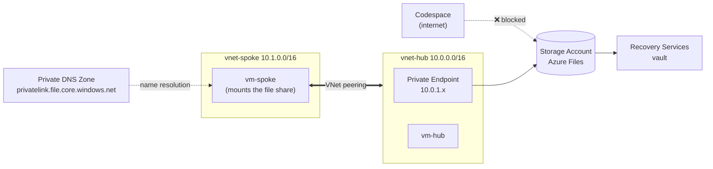

# 🔒 Azure Private Networking & Data Protection Hands-on Lab

🌐 [한국어](README.md) | **English**

[](https://codespaces.new/Taeyangmoon/azure-private-net-data-lab)
[](LICENSE)

> **Scenario**: Move an on-premises corporate file share to Azure **without exposing it to the internet**, and set up **backup**.

All you need is a browser. Every step runs in a **GitHub Codespaces** terminal with the Azure CLI. (About **85 minutes**)

## 🗺️ Final architecture



## 📚 Modules

| Module | What you do | Time | Guide |
|---|---|---|---|
| 0. Setup | Deploy hub & spoke VNets, small test VMs, a storage account | 10 min | [00-setup](docs/en/00-setup.md) |
| 1. VNet peering | Configure hub-spoke peering and test connectivity | 15 min | [01-vnet-peering](docs/en/01-vnet-peering.md) |
| 2. Private Endpoint | Configure Azure Private Link and a private DNS zone, block public access, compare `nslookup` results | 25 min | [02-private-endpoint](docs/en/02-private-endpoint.md) |
| 3. Azure Files | Create a file share and mount it from the VM over the private path | 15 min | [03-azure-files](docs/en/03-azure-files.md) |
| 4. Azure Backup | Back up Azure Files, delete a file, restore it | 15 min | [04-azure-backup](docs/en/04-azure-backup.md) |
| Cleanup | Stop protection and delete the vault | 5 min | [05-cleanup](docs/en/05-cleanup.md) |

## ✅ Prerequisites

- **Azure subscription** with permission to create resource groups (**Contributor or higher**).
- **GitHub account** for Codespaces (the free quota is enough).
- **Region**: defaults to `koreacentral`. To change it, run e.g. `export LOCATION=westeurope` before Module 0.

## 🚀 Getting started

1. Click **Open in GitHub Codespaces** above, or choose **Code ▸ Codespaces ▸ Create codespace** in the repository.
2. Sign in to Azure in the Codespace terminal.
   ```bash
   az login --use-device-code
   az account show -o table      # make sure it's the right subscription
   ```
   With multiple subscriptions, pick one using `az account set -s "<name or ID>"`.
3. Start with [Module 0](docs/en/00-setup.md) and go in order.

> 💡 **In every new terminal**, run `source scripts/env.sh` to load the shared variables (`$RG`, `$SA`, …).

## 💰 Cost

Two small VMs (`Standard_B2s`) and a little storage: roughly **US$1–2 or less per run**. But **VMs and Private Endpoints bill while they exist**, so always finish with [Cleanup](docs/en/05-cleanup.md). (Check the Azure pricing calculator for current prices.)

## 🧩 Intentional simplifications

| Area | This lab | Recommended for production |
|---|---|---|
| VM access | `az vm run-command` (no Bastion / public IP) | Azure Bastion, etc. |
| File share auth | Storage account key | Microsoft Entra Kerberos / identity-based auth |
| VM outbound | Default outbound access | NAT Gateway / firewall |
| Backup soft delete | Disabled for easy cleanup | **Keep enabled** |
| Backup redundancy | LRS | GRS, etc., per requirements |

## 📁 Repository layout

```
.devcontainer/   Codespaces environment (Azure CLI, Bicep)
infra/           Module 0 Bicep template, backup policy
scripts/         Deploy / cleanup / run-in-VM helpers
docs/ko, docs/en Step-by-step guides per module
```

## 📄 License

[MIT](LICENSE)
