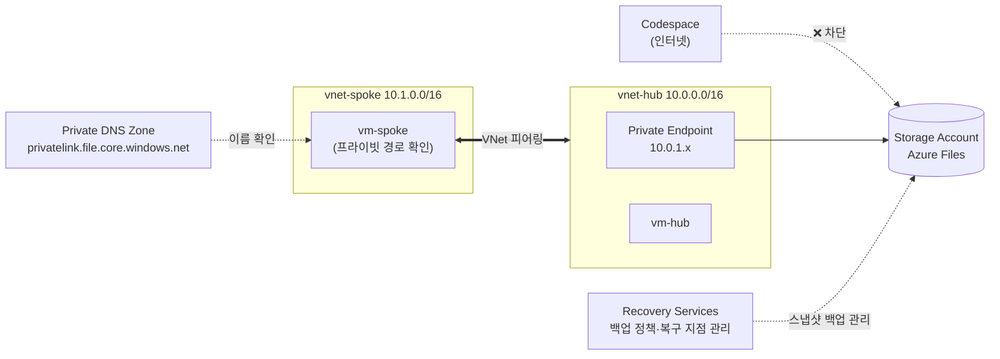

# 🔒 Azure 프라이빗 네트워크와 데이터 보호 핸즈온 랩

🌐 **한국어** | [English](README.en.md)

[](https://codespaces.new/Taeyangmoon/azure-private-net-data-lab)
[](LICENSE)

> **시나리오**: 사내 파일 공유를 위한 **프라이빗 접근 경로**를 만들고, 공유의 **백업 정책과 복구 지점**을 확인합니다.

브라우저만 있으면 됩니다. 모든 실습은 **GitHub Codespaces**의 터미널에서 Azure CLI로 진행합니다. (소요 시간 약 **75분**)

**공유 키와 공용 데이터 접근은 처음부터 끝까지 차단합니다.** 기본 실습에는 SMB 마운트, 파일 쓰기·삭제, 파일 내용 복원을 포함하지 않습니다. 조직 정책을 바꾸거나 계정 키를 직접 조회할 필요가 없습니다.

## 🗺️ 최종 아키텍처



## 📚 실습 순서

| 모듈 | 내용 | 시간 | 가이드 |
|---|---|---|---|
| 0. 준비 | 허브·스포크 VNet 2개, 테스트용 소형 VM, 스토리지 계정 배포 | 10분 | [00-setup](docs/ko/00-setup.md) |
| 1. VNet 피어링 | 허브·스포크 피어링 구성, 연결 테스트 | 15분 | [01-vnet-peering](docs/ko/01-vnet-peering.md) |
| 2. Private Endpoint | Private Link·프라이빗 DNS 구성, 사설 IP와 인터넷 403·VM 401 비교 | 20분 | [02-private-endpoint](docs/ko/02-private-endpoint.md) |
| 3. Azure Files | 관리 영역으로 공유 생성, 용량·프로토콜과 접근 경로 확인 | 10분 | [03-azure-files](docs/ko/03-azure-files.md) |
| 4. Azure Backup | Snapshot 백업 정책·보호 구성, 즉시 백업과 복구 지점 확인 | 15분 | [04-azure-backup](docs/ko/04-azure-backup.md) |
| 정리 | 보호 중지와 자격 증명 모음 삭제 | 5분 | [05-cleanup](docs/ko/05-cleanup.md) |

## ✅ 사전 준비

- **Azure 구독**: 리소스 그룹을 만들 수 있는 권한(**Contributor 이상**)이 필요합니다.
- **GitHub 계정**: Codespaces 사용 (무료 사용량으로 충분합니다).
- **스토리지 정책**: `allowSharedKeyAccess=false`, `publicNetworkAccess=Disabled` 상태를 유지합니다. 정책 예외나 공유 키 허용이 필요한 SMB 실습은 수행하지 않습니다.
- **리전**: 기본값은 `koreacentral` 입니다. 바꾸려면 `export LOCATION=japaneast` 처럼 모듈 0 전에 지정하세요.

## 🚀 시작하기

1. 위의 **Open in GitHub Codespaces** 버튼을 누르거나, 저장소에서 **Code ▸ Codespaces ▸ Create codespace** 를 선택합니다.
2. Codespace 터미널에서 Azure에 로그인합니다.
   ```bash
   az login --use-device-code
   az account show -o table      # 올바른 구독인지 확인
   ```
   구독이 여러 개라면 `az account set -s "<구독 이름 또는 ID>"` 로 선택합니다.
3. [모듈 0](docs/ko/00-setup.md)부터 차례대로 진행합니다.

> 💡 **새 터미널을 열 때마다** `source scripts/env.sh` 를 실행해 공통 변수(`$RG`, `$SA` 등)를 불러오세요.

`RG`나 `LOCATION`을 직접 지정했다면 새 터미널에서도 같은 값을 먼저 `export`하세요. 정리 스크립트는 `$RG` 전체를 삭제하므로 실습 전용 그룹만 사용하세요.

## 💰 비용 안내

소형 VM 2대(`Standard_B2s_v2`), Private Endpoint, DNS, 스토리지 및 Azure Backup 보호 인스턴스 비용이 발생합니다. 짧은 실습 1회의 예상 비용은 **대략 1~3달러**이며 리전과 실행 시간에 따라 달라집니다. 끝나면 반드시 [정리](docs/ko/05-cleanup.md)를 진행하세요. (공식 가격은 Azure 가격 계산기에서 확인)

## 🧪 검증 현황

**2026-11-07**, 실제 Azure 구독(koreacentral)에서 수정된 한국어 기본 가이드와 권장 정리 스크립트를 실행해 확인했습니다.

| 모듈 | 결과 |
|---|---|
| 0. 준비 | ✅ `Standard_B2s_v2` 배포, 공유 키 `false` · 공용 접근 `Disabled` · 기본 동작 `Deny` |
| 1. 피어링 | ✅ 피어링 전 100% 손실 → 후 양방향 0% 손실, `Connected` |
| 2. Private Endpoint | ✅ VM `10.0.1.4` / 인터넷 공용 IP, 인터넷 403 · VM 401 · TCP 445 연결 |
| 3. Azure Files | ✅ 관리 영역으로 `corpfiles` 생성, 5 GiB · SMB, 차단 설정 유지 |
| 4. Azure Backup | ✅ Snapshot 백업 `Completed`, 복구 지점 1개, 보호 상태 `Protected`, 소프트 삭제 `AlwaysON` 유지 |
| 정리 | ✅ 소프트 삭제 상태를 유지하며 재시도 후 활성 리소스 그룹 삭제 확인 (`false`) |

> 📌 검증 대상은 **빈 공유의 백업 작업과 복구 지점 생성**입니다. 이를 실제 파일 내용 복원 성공으로 해석하지 마세요.

정리 중 Azure가 컨테이너를 소프트 삭제로 전환한 뒤 `CloudInternalError`를 반환했습니다. 현재 상태를 확인해 재시도했고 활성 리소스 그룹 삭제까지 완료했습니다. 소프트 삭제의 보존 정책은 변경하지 않았습니다.

## 🧩 이 랩에서 일부러 단순화한 점

실습을 쉽게 하려고 아래를 단순화했습니다. 운영 환경에서는 다르게 구성하세요.

| 항목 | 랩 | 운영 권장 |
|---|---|---|
| VM 접속 | `az vm run-command` (Bastion/공용 IP 없음) | Azure Bastion 등 |
| 파일 데이터 작업 | 기본 실습에서는 생략 | Microsoft Entra Kerberos / ID 기반 인증 |
| VM 아웃바운드 | 기본 아웃바운드 허용 | NAT Gateway / 방화벽 |
| 자격 증명 모음 소프트 삭제 | 기본 설정·조직 정책 유지 | 보안·보존 요구사항에 맞게 유지 |
| 백업 중복성 | LRS | 요구사항에 맞게 GRS 등 |

실제 파일 쓰기·삭제·복원은 별도 확장 실습입니다. 계정 키 대신 **관리 ID + Microsoft Entra ID 인증으로 Azure Files REST API**를 사용할 수 있으며, 데이터용 RBAC 역할과 역할 부여 권한이 추가로 필요합니다. [공식 가이드](https://learn.microsoft.com/en-us/azure/storage/files/authorize-oauth-rest)

## 📁 저장소 구성

```
.devcontainer/   Codespaces 환경 (Azure CLI, Bicep)
infra/           모듈 0 Bicep 템플릿, 백업 정책
scripts/         배포·정리·VM 명령 실행 도우미
docs/ko, docs/en 모듈별 실습 가이드
tests/           VM 오류 전달·정리 스크립트 회귀 테스트
```

스크립트 회귀 테스트: `bash tests/vm-helpers.sh && bash tests/cleanup.sh`

## 📄 라이선스

[MIT](LICENSE)
