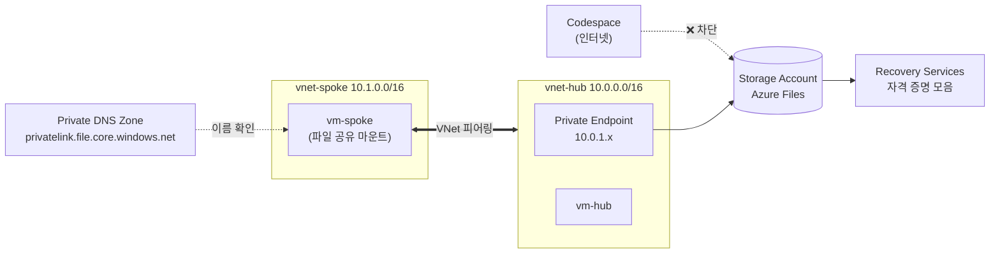

# 🔒 Azure 프라이빗 네트워크와 데이터 보호 핸즈온 랩

🌐 **한국어** | [English](README.en.md)

[](https://codespaces.new/Taeyangmoon/azure-private-net-data-lab)
[](LICENSE)

> **시나리오**: 사내 파일 공유를 **인터넷에 노출하지 않고** Azure로 옮기고, **백업**까지 구성합니다.

브라우저만 있으면 됩니다. 모든 실습은 **GitHub Codespaces**의 터미널에서 Azure CLI로 진행합니다. (소요 시간 약 **85분**)

## 🗺️ 최종 아키텍처



## 📚 실습 순서

| 모듈 | 내용 | 시간 | 가이드 |
|---|---|---|---|
| 0. 준비 | 허브·스포크 VNet 2개, 테스트용 소형 VM, 스토리지 계정 배포 | 10분 | [00-setup](docs/ko/00-setup.md) |
| 1. VNet 피어링 | 허브·스포크 피어링 구성, 연결 테스트 | 15분 | [01-vnet-peering](docs/ko/01-vnet-peering.md) |
| 2. Private Endpoint | Private Link와 프라이빗 DNS 영역 구성, 공용 액세스 차단, `nslookup` 결과 비교 | 25분 | [02-private-endpoint](docs/ko/02-private-endpoint.md) |
| 3. Azure Files | 파일 공유 생성, VM에서 프라이빗 경로로 마운트 | 15분 | [03-azure-files](docs/ko/03-azure-files.md) |
| 4. Azure Backup | Azure Files 백업 구성, 파일 삭제 후 복원 | 15분 | [04-azure-backup](docs/ko/04-azure-backup.md) |
| 정리 | 보호 중지와 자격 증명 모음 삭제 | 5분 | [05-cleanup](docs/ko/05-cleanup.md) |

## ✅ 사전 준비

- **Azure 구독**: 리소스 그룹을 만들 수 있는 권한(**Contributor 이상**)이 필요합니다.
- **GitHub 계정**: Codespaces 사용 (무료 사용량으로 충분합니다).
- **스토리지 공유 키 허용**: 모듈 3 마운트는 계정 키로 인증합니다. 조직 정책이 키 사용을 막는 구독에서는 실패하므로 개인/테스트 구독을 권장합니다.
- **리전**: 기본값은 `koreacentral` 입니다. 바꾸려면 `export LOCATION=japaneast` 처럼 모듈 0 전에 지정하세요.

## 🚀 시작하기

1. 위의 **Open in GitHub Codespaces** 버튼을 누르거나, 저장소에서 **Code ▸ Codespaces ▸ Create codespace** 를 선택합니다.
2. Codespace 터미널에서 Azure에 로그인합니다.
   ```bash
   az login --use-device-code
   az account show -o table      # 올바른 구독인지 확인
   ```
   구독이 여러 개라면 `az account set -s "<구독 이름 또는 ID>"` 로 선택합니다.
3. [모듈 0](docs/ko/00-setup.md)부터 차례대로 진행합니다.

> 💡 **새 터미널을 열 때마다** `source scripts/env.sh` 를 실행해 공통 변수(`$RG`, `$SA` 등)를 불러오세요.

## 💰 비용 안내

소형 VM 2대(`Standard_B2s_v2`)와 스토리지 소량이 전부라 **실습 1회에 대략 1~2달러 이하**입니다. 하지만 **Private Endpoint, VM은 켜 두면 계속 과금**되므로 끝나면 반드시 [정리](docs/ko/05-cleanup.md)를 진행하세요. (공식 가격은 Azure 가격 계산기에서 확인)

## 🧪 검증 현황

실제 Azure 구독(koreacentral)에서 아래를 직접 실행해 확인했습니다.

| 모듈 | 결과 |
|---|---|
| 0. 준비 | ✅ 배포 성공 (`Standard_B2s_v2`) |
| 1. 피어링 | ✅ 피어링 전 100% 손실 → 후 0% 손실 (경로 전파에 약 1분) |
| 2. Private Endpoint | ✅ VM `10.0.1.4` / 인터넷 공용 IP, 차단 후 인터넷 403 · VM 401 |
| 3. Azure Files | ⚠️ 공유 생성 ✅ / SMB 마운트는 **공유 키 허용 구독 필요** (정책이 키를 막는 구독에서는 실패) |
| 4. Azure Backup | ✅ 자격 증명 모음·정책·보호·즉시 백업·공유 복원 (공용 접근 차단 상태에서도 동작) / ⚠️ 파일 삭제 후 파일 단위 복원은 마운트 제약으로 재현하지 못함 |
| 정리 | ✅ `scripts/99-cleanup.sh` 로 리소스 그룹까지 삭제 확인 |

## 🧩 이 랩에서 일부러 단순화한 점

실습을 쉽게 하려고 아래를 단순화했습니다. 운영 환경에서는 다르게 구성하세요.

| 항목 | 랩 | 운영 권장 |
|---|---|---|
| VM 접속 | `az vm run-command` (Bastion/공용 IP 없음) | Azure Bastion 등 |
| 파일 공유 인증 | 스토리지 계정 키 | Microsoft Entra Kerberos / ID 기반 인증 |
| VM 아웃바운드 | 기본 아웃바운드 허용 | NAT Gateway / 방화벽 |
| 백업 소프트 삭제 | 정리를 쉽게 하려고 비활성화 | **켜 두기** |
| 백업 중복성 | LRS | 요구사항에 맞게 GRS 등 |

## 📁 저장소 구성

```
.devcontainer/   Codespaces 환경 (Azure CLI, Bicep)
infra/           모듈 0 Bicep 템플릿, 백업 정책
scripts/         배포·정리·VM 명령 실행 도우미
docs/ko, docs/en 모듈별 실습 가이드
```

## 📄 라이선스

[MIT](LICENSE)
