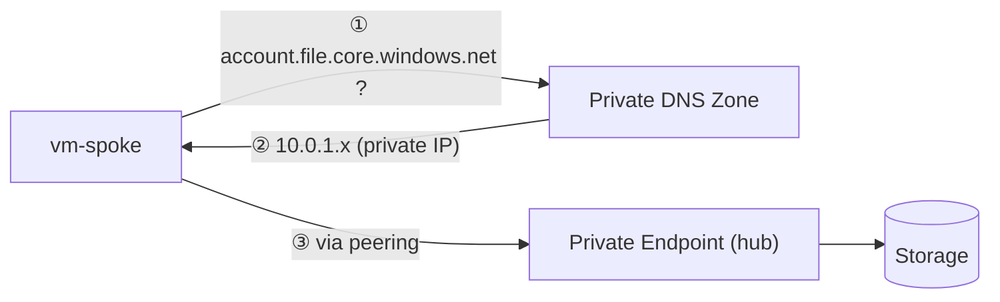

# Module 2. Private Endpoint (~25 min)

🌐 [한국어](../ko/02-private-endpoint.md) | **English**  ·  [← Home](../../README.en.md)

## 🎯 Goal

Create a **Private Endpoint** for the storage account so it's reachable only via a private IP, **block public access**, and compare how `nslookup` results change.

> 🧠 **Key concepts**
> - **Private Endpoint**: a private IP (a NIC) in your VNet. It is the **Private Link** entrance to an Azure service (here, the storage `file` sub-service).
> - **Private DNS zone** `privatelink.file.core.windows.net`: makes `<account>.file.core.windows.net` resolve to the **private IP instead of the public IP**. Without it, VMs keep trying the public IP.
> - **Blocking public access**: creating a Private Endpoint doesn't close the public path. You must block it with the firewall so data isn't exposed to the internet.



## 📝 Steps

```bash
source scripts/env.sh
echo $SA        # if empty, re-check Module 0
```

### 1. Before: record the `nslookup` results 📸

**From the VM (spoke):**

```bash
scripts/vm-exec.sh $VM_SPOKE "nslookup $SA.file.core.windows.net"
```

**From the Codespace (internet side):**

```bash
nslookup $SA.file.core.windows.net
```

👉 Both return a **public IP** (e.g. `20.x.x.x`, `52.x.x.x`). Remember this.

### 2. Create the private DNS zone and link it to the VNets

```bash
az network private-dns zone create -g $RG -n $DNS_ZONE -o none

# Link both hub and spoke (the spoke VM must resolve the name)
az network private-dns link vnet create -g $RG -z $DNS_ZONE -n link-hub \
  -v $HUB_VNET -e false -o none
az network private-dns link vnet create -g $RG -z $DNS_ZONE -n link-spoke \
  -v $SPOKE_VNET -e false -o none
```

### 3. Create the Private Endpoint (`snet-pe` in the hub VNet)

```bash
SA_ID=$(az storage account show -g $RG -n $SA --query id -o tsv)

az network private-endpoint create -g $RG -n pe-files \
  --vnet-name $HUB_VNET --subnet snet-pe \
  --private-connection-resource-id $SA_ID \
  --group-id file \
  --connection-name pe-files-conn -o none
```

`--group-id file` targets the **Azure Files** sub-service of the storage account. (Use `blob` for Blob.)

### 4. Attach the endpoint to the DNS zone (auto-registers the A record)

```bash
ZONE_ID=$(az network private-dns zone show -g $RG -n $DNS_ZONE --query id -o tsv)

az network private-endpoint dns-zone-group create -g $RG \
  --endpoint-name pe-files -n default \
  --private-dns-zone $ZONE_ID --zone-name file -o none
```

Check the registered record.

```bash
az network private-dns record-set a list -g $RG -z $DNS_ZONE \
  --query "[].{Name:name, IP:aRecords[0].ipv4Address}" -o table
```

👉 An entry named `$SA` with a `10.0.1.x` private IP should exist.

### 5. After: compare `nslookup` 📸

```bash
scripts/vm-exec.sh $VM_SPOKE "nslookup $SA.file.core.windows.net"
nslookup $SA.file.core.windows.net
```

| Where | Result | Why |
|---|---|---|
| **VM (spoke)** | alias `...privatelink.file.core.windows.net` → **10.0.1.x** (private IP) | The private DNS zone linked to the VNet answers |
| **Codespace (internet)** | still a **public IP** | Outside the linked VNets, public DNS is used |

> ⚠️ At this point the public path from the Codespace is **still open**. We block it next.

### 6. Block public access 🚫

First confirm the Codespace can still reach the storage account.

```bash
KEY=$(az storage account keys list -g $RG -n $SA --query '[0].value' -o tsv)
az storage share list --account-name $SA --account-key $KEY -o table   # succeeds (empty list)
```

Now set the firewall's default action to **Deny**.

```bash
az storage account update -g $RG -n $SA \
  --default-action Deny --bypass AzureServices -o none
```

> 🧠 `--default-action Deny` rejects all public access not on an allow list. The Private Endpoint path isn't subject to firewall rules, so it keeps working.
> `--bypass AzureServices` lets trusted Microsoft services such as Azure Backup through (needed in Module 4).

Rules can take up to a minute to apply. Try again shortly:

```bash
sleep 30
az storage share list --account-name $SA --account-key $KEY -o table
```

👉 Getting **`403 AuthorizationFailure` / `This request is not authorized to perform this operation`** means success. Even with the key, the internet can't get in. 🔒

### 7. Confirm the VM still works

```bash
scripts/vm-exec.sh $VM_SPOKE "timeout 5 bash -c '</dev/tcp/$SA.file.core.windows.net/445' && echo '✅ port 445 reachable (private path)'"
```

## ✅ Checklist

- [ ] Before: both VM and Codespace see a public IP
- [ ] After: VM sees `10.0.1.x`, Codespace still sees a public IP
- [ ] After blocking: `az storage share list` from the Codespace returns 403
- [ ] After blocking: port 445 from the VM succeeds

## 🛠️ Troubleshooting

| Symptom | Fix |
|---|---|
| VM still resolves to a public IP | Check the DNS zone is linked to the **spoke VNet too** (`az network private-dns link vnet list -g $RG -z $DNS_ZONE -o table`) and the dns-zone-group exists. Retry after 1–2 min |
| Codespace still succeeds after blocking | Rule propagation delay. Retry after a minute |
| Port 445 fails from the VM | Make sure the Module 1 peering is `Connected` |
| Policy denies changing `--default-action` | Your environment needs a policy exemption. Use a personal/test subscription |

> 💡 For a stricter setup you can use `--public-network-access Disabled` to turn the public endpoint off entirely. Check compatibility with services like Azure Backup first. This lab uses `Deny + AzureServices exception`.

➡️ Next: [Module 3. Azure Files](03-azure-files.md)
