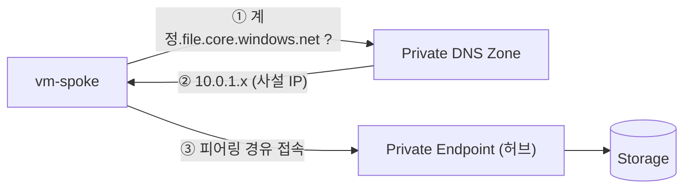

# 모듈 2. Private Endpoint (약 20분)

🌐 **한국어** | [English](../en/02-private-endpoint.md)  ·  [← 처음으로](../../README.md)

## 🎯 목표

공용 접근이 이미 차단된 스토리지 계정에 **Private Endpoint**를 연결합니다. `nslookup` 결과와 **인터넷 403 · VM 401** 응답을 비교해 프라이빗 경로를 이해합니다.

> 🧠 **핵심 개념**
> - **Private Endpoint**: VNet 안에 만드는 사설 IP(NIC). 이 IP가 Azure 서비스(여기서는 스토리지의 `file`)로 연결되는 **Private Link** 입구입니다.
> - **프라이빗 DNS 영역** `privatelink.file.core.windows.net`: `계정이름.file.core.windows.net` 을 **공용 IP 대신 사설 IP**로 해석하게 만듭니다. 이게 없으면 VM은 계속 공용 IP로 접속을 시도합니다.
> - **공용 액세스 차단**: 모듈 0에서 `publicNetworkAccess=Disabled`로 배포했습니다. 이 설정과 공유 키 차단은 실습 내내 유지하며, 비교를 위해 공용 접근을 켜지 않습니다.



## 📝 실습

```bash
source scripts/env.sh
echo $SA        # 비어 있으면 모듈 0을 다시 확인
: "${SA:?모듈 0을 먼저 배포하세요}"
```

### 1. 변경 전: `nslookup` 결과 기록 📸

**VM(스포크)에서:**

```bash
scripts/vm-exec.sh $VM_SPOKE "nslookup $SA.file.core.windows.net"
```

**Codespace(인터넷 쪽)에서:**

```bash
nslookup $SA.file.core.windows.net
```

👉 둘 다 **공용 IP**(예: `20.x.x.x`, `52.x.x.x`)가 나옵니다. 이 결과를 기억해 두세요.

> 📌 **공용 IP로 이름이 해석되는 것과 공용 데이터 접근이 허용되는 것은 다릅니다.** 이 시점에도 인터넷 요청은 아래처럼 `403 AuthorizationFailure`입니다.

```bash
curl -sS --max-time 30 -i -H "x-ms-version: 2023-11-03" \
  "https://$SA.file.core.windows.net/?comp=list" | grep -iE "^HTTP|x-ms-error-code"
```

### 2. 프라이빗 DNS 영역 만들고 VNet에 연결

```bash
az network private-dns zone create -g $RG -n $DNS_ZONE -o none

# 허브와 스포크 둘 다 연결 (스포크의 VM이 이름을 해석해야 함)
az network private-dns link vnet create -g $RG -z $DNS_ZONE -n link-hub \
  -v $HUB_VNET -e false -o none
az network private-dns link vnet create -g $RG -z $DNS_ZONE -n link-spoke \
  -v $SPOKE_VNET -e false -o none
```

### 3. Private Endpoint 생성 (허브 VNet의 `snet-pe`)

```bash
SA_ID=$(az storage account show -g $RG -n $SA --query id -o tsv)

az network private-endpoint create -g $RG -n pe-files \
  --vnet-name $HUB_VNET --subnet snet-pe \
  --private-connection-resource-id $SA_ID \
  --group-id file \
  --connection-name pe-files-conn -o none
```

`--group-id file` 은 스토리지의 **Azure Files** 하위 서비스에 연결한다는 뜻입니다. (Blob이면 `blob`)

### 4. Private Endpoint ↔ DNS 영역 연결 (A 레코드 자동 등록)

```bash
ZONE_ID=$(az network private-dns zone show -g $RG -n $DNS_ZONE --query id -o tsv)

az network private-endpoint dns-zone-group create -g $RG \
  --endpoint-name pe-files -n default \
  --private-dns-zone $ZONE_ID --zone-name file -o none
```

등록된 레코드를 확인합니다.

```bash
az network private-dns record-set a list -g $RG -z $DNS_ZONE \
  --query "[].{Name:name, IP:aRecords[0].ipv4Address}" -o table
```

👉 `$SA` 이름으로 `10.0.1.x` 사설 IP가 등록되어 있어야 합니다.

### 5. 변경 후: `nslookup` 비교 📸

```bash
scripts/vm-exec.sh $VM_SPOKE "nslookup $SA.file.core.windows.net"
nslookup $SA.file.core.windows.net
```

| 위치 | 결과 | 이유 |
|---|---|---|
| **VM (스포크)** | `...privatelink.file.core.windows.net` 별칭 → **10.0.1.x** (사설 IP) | VNet에 연결된 프라이빗 DNS 영역이 응답 |
| **Codespace (인터넷)** | 여전히 **공용 IP** | 프라이빗 DNS 영역이 연결되지 않은 곳은 공용 DNS를 사용 |

### 6. 인터넷과 VM의 응답 비교 🔍

인증 없이 같은 요청을 보내 **접근 경로만** 확인합니다. 인터넷의 공용 데이터 접근은 처음부터 차단되어 있습니다.

```bash
# 인터넷(Codespace)에서
curl -sS --max-time 30 -i -H "x-ms-version: 2023-11-03" \
  "https://$SA.file.core.windows.net/?comp=list" | grep -iE "^HTTP|x-ms-error-code"
scripts/vm-exec.sh $VM_SPOKE "curl -sS --max-time 30 -i -H 'x-ms-version: 2023-11-03' 'https://$SA.file.core.windows.net/?comp=list' | grep -iE '^HTTP|x-ms-error-code'"
```

| 위치 | 응답 | 의미 |
|---|---|---|
| 인터넷 | `403 AuthorizationFailure` | 공용 데이터 접근 차단 |
| VM | `401 NoAuthenticationInformation` | 프라이빗 경로로 서비스에 도달했지만 인증 정보 없음 |

> 📌 **401은 파일 읽기·쓰기 성공이 아닙니다.** 네트워크 연결과 데이터 인증은 별도이며, 파일 데이터 인증은 기본 실습 범위가 아닙니다.

### 7. SMB 포트의 네트워크 연결 확인

```bash
scripts/vm-exec.sh $VM_SPOKE "timeout 5 bash -c '</dev/tcp/$SA.file.core.windows.net/445' && echo '✅ 445 포트 연결 성공 (프라이빗 경로)'"
```

👉 TCP 445 연결은 성공하지만 SMB 마운트·인증을 시도하지는 않습니다. 공유 키가 차단된 정책을 그대로 유지합니다.

## ✅ 확인 체크리스트

- [ ] 변경 전: VM·Codespace 모두 공용 IP
- [ ] 변경 후: VM은 `10.0.1.x`, Codespace는 공용 IP
- [ ] 처음부터 끝까지: Codespace의 `curl` 이 `403 AuthorizationFailure`
- [ ] 프라이빗 경로 구성 후: VM에서 445 포트 연결 성공, `curl` 은 `401`

## 🛠️ 문제 해결

| 증상 | 해결 |
|---|---|
| VM에서 여전히 공용 IP | DNS 영역이 **스포크 VNet에도** 연결됐는지 (`az network private-dns link vnet list -g $RG -z $DNS_ZONE -o table`), dns-zone-group을 만들었는지 확인. 1~2분 후 재시도 |
| Codespace에서 401이 나옴 | 모듈 0의 `publicNetworkAccess=Disabled`, `defaultAction=Deny` 설정인지 확인하세요. 비교를 위해 공용 접근을 켜지 마세요 |
| VM에서 445 연결 실패 | 모듈 1의 피어링이 `Connected` 인지 확인 |

➡️ 다음: [모듈 3. Azure Files](03-azure-files.md)
