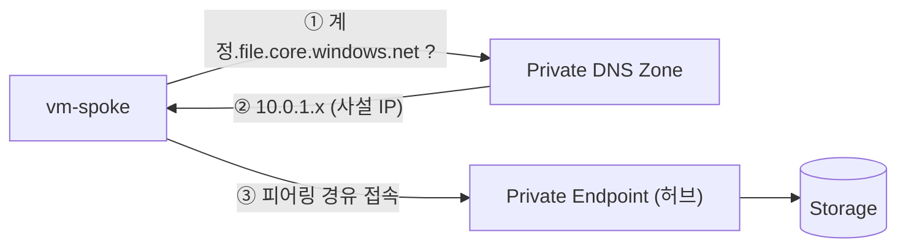

# 모듈 2. Private Endpoint (약 25분)

🌐 **한국어** | [English](../en/02-private-endpoint.md)  ·  [← 처음으로](../../README.md)

## 🎯 목표

스토리지 계정에 **Private Endpoint**를 만들어 사설 IP로만 접근하게 하고, **공용 접근을 차단**합니다. 그리고 `nslookup` 결과가 어떻게 달라지는지 비교합니다.

> 🧠 **핵심 개념**
> - **Private Endpoint**: VNet 안에 만드는 사설 IP(NIC). 이 IP가 Azure 서비스(여기서는 스토리지의 `file`)로 연결되는 **Private Link** 입구입니다.
> - **프라이빗 DNS 영역** `privatelink.file.core.windows.net`: `계정이름.file.core.windows.net` 을 **공용 IP 대신 사설 IP**로 해석하게 만듭니다. 이게 없으면 VM은 계속 공용 IP로 접속을 시도합니다.
> - **공용 액세스 차단**: Private Endpoint를 만들어도 공용 경로는 열려 있습니다. 방화벽으로 막아야 데이터가 인터넷에 노출되지 않습니다.



## 📝 실습

```bash
source scripts/env.sh
echo $SA        # 비어 있으면 모듈 0을 다시 확인
```

### 1. 변경 전: `nslookup` 결과 기록 📸

**VM(스포크)에서:**

```bash
scripts/vm-exec.sh $VM_SPOKE "nslookup $SA.file.core.windows.net"
```

**Codespace(인터넷 쪽)에서:**

```bash
nslookup $SA.file.core.windows.net
```

👉 둘 다 **공용 IP**(예: `20.x.x.x`, `52.x.x.x`)가 나옵니다. 이 결과를 기억해 두세요.

### 2. 프라이빗 DNS 영역 만들고 VNet에 연결

```bash
az network private-dns zone create -g $RG -n $DNS_ZONE -o none

# 허브와 스포크 둘 다 연결 (스포크의 VM이 이름을 해석해야 함)
az network private-dns link vnet create -g $RG -z $DNS_ZONE -n link-hub \
  -v $HUB_VNET -e false -o none
az network private-dns link vnet create -g $RG -z $DNS_ZONE -n link-spoke \
  -v $SPOKE_VNET -e false -o none
```

### 3. Private Endpoint 생성 (허브 VNet의 `snet-pe`)

```bash
SA_ID=$(az storage account show -g $RG -n $SA --query id -o tsv)

az network private-endpoint create -g $RG -n pe-files \
  --vnet-name $HUB_VNET --subnet snet-pe \
  --private-connection-resource-id $SA_ID \
  --group-id file \
  --connection-name pe-files-conn -o none
```

`--group-id file` 은 스토리지의 **Azure Files** 하위 서비스에 연결한다는 뜻입니다. (Blob이면 `blob`)

### 4. Private Endpoint ↔ DNS 영역 연결 (A 레코드 자동 등록)

```bash
ZONE_ID=$(az network private-dns zone show -g $RG -n $DNS_ZONE --query id -o tsv)

az network private-endpoint dns-zone-group create -g $RG \
  --endpoint-name pe-files -n default \
  --private-dns-zone $ZONE_ID --zone-name file -o none
```

등록된 레코드를 확인합니다.

```bash
az network private-dns record-set a list -g $RG -z $DNS_ZONE \
  --query "[].{이름:name, IP:aRecords[0].ipv4Address}" -o table
```

👉 `$SA` 이름으로 `10.0.1.x` 사설 IP가 등록되어 있어야 합니다.

### 5. 변경 후: `nslookup` 비교 📸

```bash
scripts/vm-exec.sh $VM_SPOKE "nslookup $SA.file.core.windows.net"
nslookup $SA.file.core.windows.net
```

| 위치 | 결과 | 이유 |
|---|---|---|
| **VM (스포크)** | `...privatelink.file.core.windows.net` 별칭 → **10.0.1.x** (사설 IP) | VNet에 연결된 프라이빗 DNS 영역이 응답 |
| **Codespace (인터넷)** | 여전히 **공용 IP** | 프라이빗 DNS 영역이 연결되지 않은 곳은 공용 DNS를 사용 |

> ⚠️ 이 시점에서도 Codespace → 스토리지 공용 경로는 **아직 열려 있습니다.** 다음 단계에서 막습니다.

### 6. 공용 액세스 차단 🚫

먼저 차단 전에 Codespace에서 접근이 되는지 확인합니다.

```bash
KEY=$(az storage account keys list -g $RG -n $SA --query '[0].value' -o tsv)
az storage share list --account-name $SA --account-key $KEY -o table   # 성공 (빈 목록)
```

이제 방화벽 기본 동작을 **거부**로 바꿉니다.

```bash
az storage account update -g $RG -n $SA \
  --default-action Deny --bypass AzureServices -o none
```

> 🧠 `--default-action Deny`: 허용 목록에 없는 공용 접근을 모두 거부합니다. Private Endpoint 경로는 방화벽 규칙의 영향을 받지 않아 계속 동작합니다.
> `--bypass AzureServices`: Azure Backup 같은 신뢰할 수 있는 Microsoft 서비스는 허용합니다. (모듈 4에서 필요)

규칙이 반영되는 데 최대 1분 정도 걸립니다. 잠시 후 다시 시도합니다.

```bash
sleep 30
az storage share list --account-name $SA --account-key $KEY -o table
```

👉 **`403 AuthorizationFailure` / `This request is not authorized to perform this operation`** 오류가 나면 성공입니다. 키를 갖고 있어도 인터넷에서는 접근할 수 없습니다. 🔒

### 7. VM에서는 여전히 되는지 확인

```bash
scripts/vm-exec.sh $VM_SPOKE "timeout 5 bash -c '</dev/tcp/$SA.file.core.windows.net/445' && echo '✅ 445 포트 연결 성공 (프라이빗 경로)'"
```

## ✅ 확인 체크리스트

- [ ] 변경 전: VM·Codespace 모두 공용 IP
- [ ] 변경 후: VM은 `10.0.1.x`, Codespace는 공용 IP
- [ ] 공용 차단 후: Codespace에서 `az storage share list` 가 403
- [ ] 공용 차단 후: VM에서 445 포트 연결 성공

## 🛠️ 문제 해결

| 증상 | 해결 |
|---|---|
| VM에서 여전히 공용 IP | DNS 영역이 **스포크 VNet에도** 연결됐는지 (`az network private-dns link vnet list -g $RG -z $DNS_ZONE -o table`), dns-zone-group을 만들었는지 확인. 1~2분 후 재시도 |
| 차단했는데 Codespace에서 계속 성공 | 규칙 반영 지연입니다. 1분 뒤 재시도 |
| VM에서 445 연결 실패 | 모듈 1의 피어링이 `Connected` 인지 확인 |
| 구독 정책으로 `--default-action` 변경 거부 | 정책 예외가 필요한 환경입니다. 개인/테스트 구독 사용 |

> 💡 더 엄격하게 `--public-network-access Disabled` 로 공용 엔드포인트 자체를 끌 수도 있습니다. 다만 Azure Backup 등 서비스와의 호환성을 먼저 확인하세요. 이 랩은 `Deny + AzureServices 예외` 방식을 사용합니다.

➡️ 다음: [모듈 3. Azure Files](03-azure-files.md)
